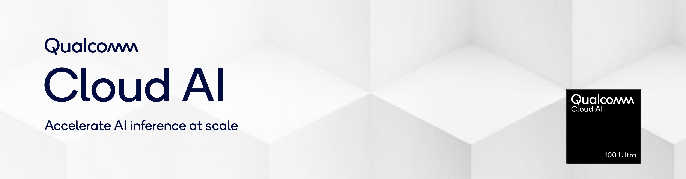

<p align="center">
  <picture>
    
  </picture>
</p>


<p style="font-size: 20px" align="center">
| <a href="https://qualcomm.github.io/cloud-ai-sdk-pages/latest/"><b>User Guide</b></a> | <a href="https://qualcomm.github.io/cloud-ai-sdk-pages/latest/Getting-Started/Installation/"><b>Download SDK</b></a> | <a href="https://qualcomm.github.io/cloud-ai-sdk-pages/latest/blogs/Train_Anywhere/train_anywhere/"><b>Blog</b></a> |

</p>

# Qualcomm Cloud AI Developer Resources

Model recipes, tutorials, inference samples, and tools for developing on Qualcomm Cloud AI accelerators.

## Explore the Repository

| Resource | What you'll find |
| --- | --- |
| [`qaic_models`](qaic_models/README.md) | Installable recipes for vision and text-to-speech: export, compile, run, and serve with Triton where supported. |
| [Model examples](models/) | Standalone vision, NLP encoder, and Stable Diffusion recipes with their own setup instructions. |
| [Tutorials](tutorials/README.md) | Notebooks and guides for model onboarding, performance tuning, profiling, and integrations. |
| [Python](samples/python) and [C++](samples/cpp/cpp_qpc_inference) samples | Inference API examples. |
| [Utilities](utils/README.md) | Benchmarking and device configuration tools. |
| [Agent skills](skills/README.md) | Reusable workflows for model onboarding, compilation, performance tuning, and serving with coding agents. |

For LLMs, VLMs, embeddings, speech recognition, and additional image and video generation workflows, see the [Qualcomm Efficient Transformers library](https://github.com/qualcomm/efficient-transformers) and its supported model catalog.

## Quick Start

### 1. YOLO11 Object Detection (`qaic_models`)

Run from the repository root in a Python 3.12 environment inside the [Cloud AI SDK container](https://github.com/qualcomm/cloud-ai-containers/pkgs/container/cloud_ai_inference_ubuntu24), so the compiler tools and devices are visible:

```bash
python3.12 -m venv env_yolo11
source env_yolo11/bin/activate
pip install -e ".[yolo11]"

# Export ONNX and compile latency/throughput QPCs
python -m qaic_models.vision.ultralytics.yolo11.detect.export \
  --variant yolo11m --work-dir build/yolo11 \
  --compile-latency --compile-throughput

# Run detection on the sample image
python -m qaic_models.vision.ultralytics.yolo11.detect.demo \
  --image build/yolo11/zidane.jpg --model build/yolo11 \
  --provider QAicExecutionProvider --out build/yolo11/zidane_qaic.jpg
```

Check results in `build/yolo11/zidane_qaic.jpg`. See the [YOLO11 Detect recipe](qaic_models/vision/ultralytics/yolo11/detect) for other sizes or the [recipe catalog](qaic_models/README.md) for YOLO26 and classification.

### 2. LLM with vLLM Container

```bash
docker run --rm -it --network host \
   --device /dev/accel/ \
   --shm-size=2gb \
   --mount type=bind,source=$HOME/.cache,target=/cache \
   -e HF_HOME=/cache/huggingface \
   -e QEFF_HOME=/cache/qeff_models \
   ghcr.io/qualcomm/cloud_ai_inference_vllm:1.23.2.0 \
   --host 127.0.0.1 \
   --port 8080 \
   --model hugging-quants/Meta-Llama-3.1-8B-Instruct-AWQ-INT4 \
   --max-model-len 8192 \
   --max-num-seq 1 \
   --max-seq-len-to-capture 128 \
   --quantization mxfp6 \
   --kv-cache-dtype mxint8
```

See the [vLLM for QAic User Guide](https://qualcomm.github.io/cloud-ai-sdk-pages/latest/Getting-Started/Model-Serving/vLLM-Serving) for setup and serving options.

Once the server is ready, send a request from another terminal:

```bash
curl http://127.0.0.1:8080/v1/chat/completions \
  -H "Content-Type: application/json" \
  -d '{
    "model": "hugging-quants/Meta-Llama-3.1-8B-Instruct-AWQ-INT4",
    "messages": [{"role": "user", "content": "<your prompt>"}]
  }'
```

### 3. Text-to-Image with Stable Diffusion (Docker)

Follow the [SDXL-Turbo prerequisites](models/multimodal/text_to_image/sdxl_turbo), then run from the repository root:

```bash
cd models/multimodal/text_to_image/sdxl_turbo
docker compose build
docker compose run --rm export   # ONNX generation + QPC compiles (~50 GB disk)
docker compose run --rm inference --prompt "<your prompt>"
```

The generated image is written to `images/` in the recipe folder. The other Stable Diffusion recipes listed below use the same Compose workflow.

## Model Catalog

- **Detection and classification:** [YOLO11/YOLO26](qaic_models/vision/ultralytics); [additional vision recipes](models/vision/README.md) include earlier YOLO versions, ResNet, ViT, MobileNet, and EfficientNet.
- **OCR and instance segmentation:** [LPRNet](qaic_models/vision/ocr/lprnet), [PaddleOCR](qaic_models/vision/ocr/paddle_ocr), and [Mask R-CNN](qaic_models/vision/segmentation/mask_rcnn).
- **Text-to-speech:** [F5-TTS](qaic_models/speech/f5_tts).
- **Text-to-image:** [SD3.5-Medium](models/multimodal/text_to_image/stable-diffusion-3.5-medium), [SDXL](models/multimodal/text_to_image/stable-diffusion-xl-base-1.0), [SDXL-Turbo](models/multimodal/text_to_image/sdxl_turbo), and [SDXL-DeepCache](models/multimodal/text_to_image/sdxl_deepcache).
- **NLP encoders:** [BERT and sentence-transformer recipes](models/language_processing/encoder).

For pre-compiled model binaries, see the [Model Catalog](https://dc00tk1pxen80.cloudfront.net/) (independent partner site).

## Latest News

- **2026/10:** Added the installable [`qaic_models`](qaic_models/README.md) package for vision and text-to-speech recipes.
- **2026/10:** Added [Cloud AI agent skills](skills/README.md), including autonomous model onboarding.
- **2026/10:** Added Docker Compose workflows for exporting, compiling, and running the four [Stable Diffusion recipes](#model-catalog).

## Support

Reach out on the [📢cloud-ai Discord channel](https://discord.com/invite/qualcommdevelopernetwork) or use [💬 GitHub Issues](https://github.com/qualcomm/cloud-ai-sdk/issues) to request for model support, raise questions or to provide feedback.

## Disclaimer

While this repository may provide documentation on how to run models on Qualcomm Cloud AI platforms, this repository does NOT contain any of these models.  All models referenced in this documentation are independently provided by third parties at unaffiliated websites. Please be sure to review any third-party license terms at these websites; no license to any model is provided in this repository. This repository of documentation provides no warranty or assurances for any model so please also be sure to review all model cards, model descriptions, model limitations / intended uses, training data, biases, risks, and any other warnings given by the third party  model providers.

## License

The documentation made available in this repository is licensed under the BSD 3-clause-Clear “New” or “Revised” License. Check out the [LICENSE](LICENSE) for more details.
